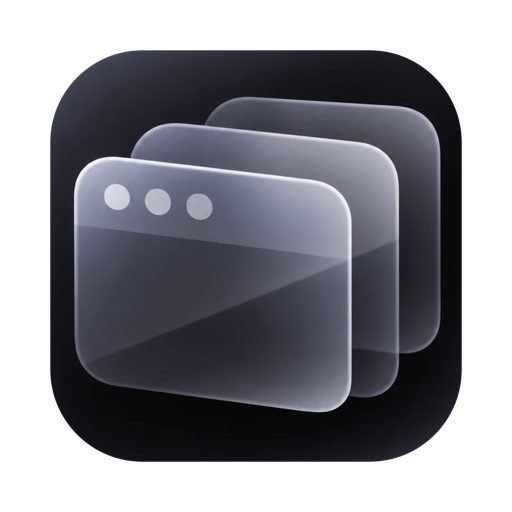
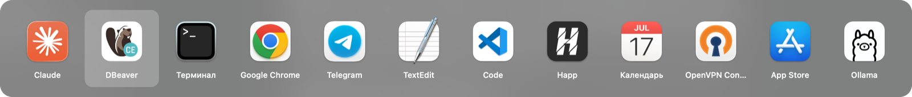

<p align="center"></p>

# SimpleScreenTab

**[Русская версия ниже](#русский)**

A tiny, free macOS app switcher that makes **Cmd-Tab show only the apps on the display your mouse is on**. On a multi-monitor Mac the built-in Cmd-Tab always lists every window from every screen; SimpleScreenTab replaces it with a switcher scoped to the current monitor, so you flip between the windows that are actually in front of you.

Written in a single Swift file, about 300 lines, no dependencies, no telemetry, no account, no paid tiers. It is a lightweight alternative to AltTab and Witch for the one thing most multi-display users want: a per-monitor Cmd-Tab.



## Download

| Platform | File | Install |
|---|---|---|
| macOS 13+ (Apple Silicon + Intel) | [SimpleScreenTab-1.3.0.zip](https://github.com/k33ssa/SimpleScreenTab/releases/download/v1.3.0/SimpleScreenTab-1.3.0.zip) | `brew install --cask k33ssa/tap/simplescreentab` |

macOS only. All versions: [Releases](https://github.com/k33ssa/SimpleScreenTab/releases).

## Install / Update

**Homebrew** (recommended, updates with `brew upgrade`):

```bash
brew install --cask k33ssa/tap/simplescreentab
```

**Download:** grab `SimpleScreenTab-x.y.z.zip` from [Releases](https://github.com/k33ssa/SimpleScreenTab/releases/latest), move `SimpleScreenTab.app` to Applications and open it. The app is free and not notarized, so if macOS refuses to open it, run `xattr -dr com.apple.quarantine /Applications/SimpleScreenTab.app` once.

**Build from source in one line** (needs Xcode Command Line Tools; re-run to update):

```bash
curl -fsSL https://raw.githubusercontent.com/k33ssa/SimpleScreenTab/master/install.sh | bash
```

On first run, allow Accessibility when macOS asks (System Settings -> Privacy & Security -> Accessibility). The app adds itself to login items.

To uninstall: `brew uninstall --cask simplescreentab`, or for a source build:

```bash
curl -fsSL https://raw.githubusercontent.com/k33ssa/SimpleScreenTab/master/install.sh | bash -s -- uninstall
```

**Auto-update.** `brew upgrade` picks up new versions; to let Homebrew update everything by itself in the background (once a day), run once:

```bash
brew tap homebrew/autoupdate && brew autoupdate start --upgrade --cleanup
```

## What it does

- **Cmd-Tab switches apps on the current screen only** — the display under the mouse pointer.
- Hold Cmd, press Tab / Shift-Tab (or Left / Right) to move the selection; release Cmd to switch.
- Point at an icon to select it, click to switch right away. Moving the mouse outside the icons keeps the selection.
- Raises the specific window that lives on that monitor, not a random window of the app.
- `Esc` cancels. `Cmd-Q` while the switcher is open quits the highlighted app.
- Rounded, blurred HUD panel centered on the active monitor.
- Runs as a menu-bar background item, starts at login.

## Why

macOS has no setting to limit Cmd-Tab to one display. If you work across two or three monitors, the default switcher forces you to scan windows from screens you are not even looking at. Paid tools solve this, but a per-monitor switcher is a small amount of code and should not cost money. SimpleScreenTab is that small amount of code.

## Requirements

- macOS 13 (Ventura) or newer, Apple Silicon or Intel.
- Accessibility permission (to intercept Cmd-Tab and raise windows). macOS prompts for it on first launch.

## Build from source

If you prefer to build manually instead of the one-liner above (no Xcode project needed, just the command-line tools):

```bash
git clone https://github.com/k33ssa/SimpleScreenTab.git
cd SimpleScreenTab
./build.sh
```

`build.sh` compiles `main.swift`, assembles `SimpleScreenTab.app` into `/Applications`, ad-hoc signs it, and installs a Login Item so it starts automatically.

## Usage

Once Accessibility is granted, just press **Cmd-Tab** on any monitor. The switcher appears centered on that monitor and lists only its windows.

The menu-bar icon shows it is running. Quit from the menu-bar menu; the app must be running for Cmd-Tab to be overridden.

## How it works

- `CGEventTap` intercepts Cmd-Tab before the system switcher sees it.
- `CGWindowListCopyWindowInfo` enumerates on-screen windows; each is matched to a display with `NSScreen`, keeping only those whose window bounds fall on the monitor under the mouse.
- The Accessibility API (`AXUIElement`) raises the exact window on that screen.

## License

MIT. Do what you like. This is original code, not derived from any other switcher.

## Keywords

macOS Cmd-Tab per monitor, app switcher current display only, per-screen window switcher Mac, limit Cmd-Tab to one monitor, free AltTab alternative, multi-monitor app switcher macOS, show only current screen apps Cmd-Tab, Swift macOS window switcher.

---

<a id="русский"></a>

## Русский

**SimpleScreenTab** — бесплатный переключатель приложений для macOS: по **⌘Tab** показывает только приложения с того монитора, где сейчас курсор. Стандартный ⌘Tab на нескольких мониторах всегда показывает все окна со всех экранов, а настройки, чтобы это ограничить, в macOS нет. Платные программы это умеют, но для одной этой функции хватает маленького приложения: один файл на Swift, около 300 строк, без зависимостей, телеметрии и аккаунтов. Лёгкая альтернатива AltTab и Witch.

### Скачать

| Система | Файл | Установка |
|---|---|---|
| macOS 13+ (Apple Silicon и Intel) | [SimpleScreenTab-1.3.0.zip](https://github.com/k33ssa/SimpleScreenTab/releases/download/v1.3.0/SimpleScreenTab-1.3.0.zip) | `brew install --cask k33ssa/tap/simplescreentab` |

Только macOS: приложение построено на маковских API окон и Универсального доступа, версии для Windows нет.

### Установка и обновление

```bash
brew install --cask k33ssa/tap/simplescreentab
```

- Обновление: `brew upgrade --cask simplescreentab`
- **Автообновление** в фоне (раз в сутки), выполнить один раз: `brew tap homebrew/autoupdate && brew autoupdate start --upgrade --cleanup`
- Удаление: `brew uninstall --cask simplescreentab`

Без Homebrew: скачать zip, перенести SimpleScreenTab.app в «Программы» и открыть. Приложение бесплатное и не заверено Apple; если macOS не даёт его открыть, один раз выполнить `xattr -dr com.apple.quarantine /Applications/SimpleScreenTab.app`.

При первом запуске macOS попросит разрешение «Универсальный доступ» — включить. Дальше приложение само запускается при входе.

### Как пользоваться

- **⌘Tab** — список приложений только с монитора под курсором.
- Держа ⌘, Tab / ⇧Tab (или ← / →) двигают выбор; отпустить ⌘ — переключиться.
- Навести курсор на иконку — выбрать её, кликнуть — сразу переключиться. Вне иконок выбор не меняется.
- Поднимается именно то окно, что на этом мониторе, а не случайное окно приложения.
- `Esc` — отмена, `⌘Q` в списке — закрыть выбранное приложение.
- Полноэкранные окна в список не попадают.
